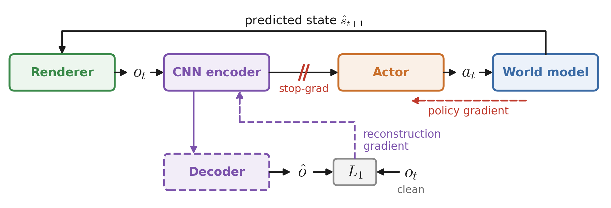

# InstinctMJ · SuperMimic

[](https://github.com/mujocolab/mjlab)
[](https://github.com/google-deepmind/mujoco_warp)
[](https://docs.python.org/3/)
[](https://github.com/project-instinct/instinct_rl)

This branch trains the G1 perceptive shadowing parkour policy (depth camera) with **SuperMimic**: the simulator only collects data,
a differentiable world model predicts the robot state, and the policy is trained by backpropagation through 32-step imagined
rollouts. No PPO. Two tasks implement the two ways vision enters imagination: `Instinct-Perceptive-Shadowing-Render-G1-v0` renders
the depth image of every imagined state from the known scene by ray casting (MuJoCo Warp), `Instinct-Perceptive-Shadowing-Latent-G1-v0`
lets the world model predict the latent of the policy's depth encoder. InstinctMJ is the `mjlab` port of
[InstinctLab](https://github.com/project-instinct/InstinctLab) ([Project-Instinct](https://project-instinct.github.io/)).



One RTX 3090, 1024 environments, 8000 iterations, the 10 motions of the released dataset (diveroll, knee climb onto a 50 cm step,
jump-sit, roll vault): **94.9% success** with the Render task, **96.9%** with the Latent task. Method, results and configuration:
[src/instinct_mj/rl/supermimic/README.md](src/instinct_mj/rl/supermimic/README.md).

## Installation

```bash
curl -LsSf https://astral.sh/uv/install.sh | sh   # if uv is not installed
uv sync
```

- Python 3.10–3.13, Linux x86_64.
- `mjlab 1.6.0` must be next to this directory as `../mjlab` (installed editable from that path).
- `instinct_rl 1.0.2` is installed from the commit recorded in `uv.lock`.

## Data and weights

Download from the [SuperMimic release](https://github.com/project-instinct/InstinctMJ/releases/latest):

- `20251116_50cm_kneeClimbStep1.zip`: the dataset. Unzip into `~/Datasets/` (the default `MOTION_FOLDER` in
  `src/instinct_mj/tasks/shadowing/perceptive/config/g1/perceptive_shadowing_cfg.py`).
- The trained policy checkpoint and its ONNX export. The world-model state in the release belongs to the original visual-latent
  run (before the Latent task was merged) and cannot be resumed; the policy checkpoint plays and exports as is.

## Usage

```bash
# train
uv run instinct-train Instinct-Perceptive-Shadowing-Render-G1-v0 --num-envs 1024   # or ...-Latent-G1-v0
# evaluate (success rate per motion)
uv run python -m instinct_mj.scripts.supermimic.evaluate --checkpoint <run>/model_<it>.pt --motion-folder ~/Datasets/20251116_50cm_kneeClimbStep1 --num-envs 128
# web viewer (viser)
uv run python webplay_supermimic.py <run>/model_<it>.pt
# play + ONNX export
uv run instinct-play Instinct-Perceptive-Shadowing-Render-G1-Play-v0 --checkpoint-file <run>/model_<it>.pt --viewer none --export-onnx True
```

Runs are written to `logs/instinct_rl/g1_perceptive_shadowing/`.

## Acknowledgements

This work builds on **SuperMimic** (Liao et al., CoRL 2026), whose method this branch follows, and on
[**supermimic_vibed**](https://github.com/zita-ch/supermimic_vibed) by Chong Zhang (ETH Zurich, MIT License), the open
reproduction from which the world model, replay buffer, rotation utilities and training loop were adapted. Many thanks to the
authors of both. This branch is not affiliated with the SuperMimic authors.

```bibtex
@misc{liao2026supermimic,
  title         = {SuperMimic: Scaling Humanoid Whole-Body Control with One Differentiable World Model},
  author        = {Liao, Qiayuan and Shao, Yiyang and Long, Junfeng and Zakka, Kevin and Horowitz, Roberto and Abbeel, Pieter and Sreenath, Koushil},
  year          = {2026},
  eprint        = {2610.28480},
  archivePrefix = {arXiv},
  primaryClass  = {cs.RO},
  note          = {CoRL 2026},
  url           = {https://arxiv.org/abs/2610.28480}
}

@misc{zhang2026supermimicvibed,
  title        = {supermimic\_vibed: an open reproduction of SuperMimic},
  author       = {Zhang, Chong},
  year         = {2026},
  howpublished = {\url{https://github.com/zita-ch/supermimic_vibed}}
}
```

## License

[CC BY-NC 4.0](LICENSE): no commercial use. Contributions: see [CONTRIBUTING.md](CONTRIBUTING.md) and
[CONTRIBUTOR_AGREEMENT.md](CONTRIBUTOR_AGREEMENT.md).

Checkpoints trained outside InstinctMJ are not compatible: the joint order comes from the MJCF and differs from IsaacLab.
