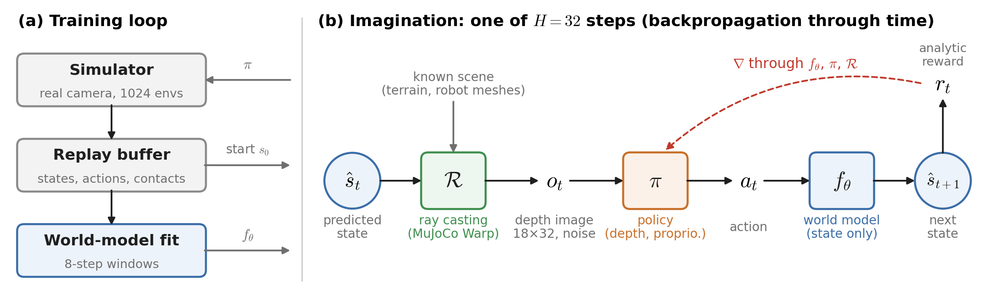

# SuperMimic world-model training for perceptive shadowing parkour (G1)

**Two vision methods** (`--agent.vision latent | render`, default `render`). Both share the world model, critic, failure head and
the task's policy; they differ in how the depth image enters imagination. `render`: the world model predicts the robot state only and
every imagined step renders the depth image of the predicted state by ray casting; the policy's own depth encoder E acts on it.
`latent`: the world-model state also carries the latent z of E, the world model predicts it, E is trained by a reconstruction
decoder and nothing is rendered in imagination (the buffer stores depth images instead). Results (success / link pos / joint pos
error): latent 96.9% / 0.044 m / 0.134 rad at iteration 8000 (128 episodes, original run); render + plan D (see **Encoder training**)
93.8% / 0.047 m / 0.139 rad; render + plan D + value head (no annealing) 93.1% at 6000 and 87.4% at 8000 vs plan D alone 74.2% / 91.0%
(3 seeds x 256 envs).

```bash
# latent (the setting of the 96.9% run)
instinct-train Instinct-Perceptive-Shadowing-G1-v0 --num-envs 1024 --agent.max-iterations 8000 --agent.vision latent \
    --agent.fail-head False --agent.wm-failure-frac 0 --agent.wm-holdout-envs 0
# render (plan D + annealed value head)
instinct-train Instinct-Perceptive-Shadowing-G1-v0 --num-envs 1024 --agent.max-iterations 8000 --agent.encoder-policy-grad 0 \
    --agent.aux-recon-weight 1.0 --agent.aux-value-weight 1.0 --agent.aux-value-anneal-start 3000 --agent.aux-value-anneal-end 6000
```

`latent` excludes `encoder_policy_grad` != 1, `aux_recon_weight` > 0, `aux_value_weight` > 0 and `latent_policy_grad` != 0 (they act on
the rendered path; setting them raises a `ValueError`); `render` ignores the `latent_*` fields. The rest of this README describes
the `render` method.

Trains the depth policy of `Instinct-Perceptive-Shadowing-G1-v0` inside a learned world model, following
[SuperMimic](https://arxiv.org/abs/2610.28480) (Liao et al., CoRL 2026) and its open reproduction
[supermimic_vibed](https://github.com/zita-ch/supermimic_vibed) (MIT, Chong Zhang).

- **Single stage, no PPO.** The simulator only collects data. A differentiable world model is fit to it, and the policy is trained by
  back-propagation through 32-step imagined rollouts with analytic task rewards and a critic bootstrap.
- **Vision is a function of the state, not part of it.** The world model predicts the robot state only. In imagination the depth
  image of every predicted state is rendered differentiably from the known scene, terrain and robot meshes (the env camera's own
  MuJoCo Warp ray-cast kernel, gradient through the hit normal), and passed through the camera's own noise pipeline; the policy's
  depth encoder is trained end-to-end by the policy loss.
- **Unchanged task and policy.** All domain randomization, camera noise and resets of the task are kept. The policy is the task's
  `EncoderActorCritic` (Conv2d depth encoder); checkpoints use the `OnPolicyRunner` format, so `instinct-play` and its ONNX export
  load them unchanged.



(a) The simulator only collects data; the world model is fit on 8-step windows. (b) In imagination the policy acts on the depth
image rendered from the predicted state by differentiable ray casting, and the gradient of the return flows back through the world
model, the policy and the renderer.

## Results

One RTX 3090, 1024 environments, dataset `20251116_50cm_kneeClimbStep1` (10 motions on 5 terrains). Play setting (each motion from
its first frame, no pushes, camera noise on, the three tracking terminations on), 12–13 episodes per motion; success = the whole
motion without any termination.

| Iteration | Training time | Success | Completion | Link pos error | Joint pos error |
|---|---|---|---|---|---|
| 2000 | 0.6 h | 9% | 45% | 0.058 m | 0.144 rad |
| 4000 | 1.3 h | 71% | 81% | 0.058 m | 0.158 rad |
| 6000 | 2.0 h | 82% | 91% | 0.057 m | 0.170 rad |
| 8000 | 2.8 h | 95% | 97% | 0.049 m | 0.148 rad |

Per motion at iteration 8000: diveroll4 (4 terrains) 100%, rollVault11 100% / 100%, jumpsit2 100% / 92%, kneelClimbStep1
85% / 69% (with / without wall). One seed, default flags; training time only (no evaluation during training). For reference, the
earlier version with a visual latent in the world-model state reached 97% at iteration 8000 (with `--agent.fail-head False
--agent.wm-failure-frac 0 --agent.wm-holdout-envs 0`; 0.044 m link error), and the version with a learned depth-image head 95%.

## Method

```
for each iteration:
    1. collect   run the current policy (+ action noise) in the task env for ~2.5 steps (UTD 0.4), store transitions
    2. fit WM    10 batches of k=8-step autoregressive windows: dynamics + contact (+ failure) losses
    3. policy    from real buffered states, imagine 32 steps with the frozen world model; analytic reward and soft
                 termination, critic bootstrap after 32 steps; maximize the return by BPTT
    4. critic    regress GAE(λ) targets computed on the imagined transitions
```

The first 500 iterations only fit the world model. Optimizers, learning rate (2e-4, cosine decay), gradient clipping, γ = 0.99,
λ = 0.95 and the update-to-data ratio follow SuperMimic.

**World model** (9.7M parameters, deterministic): MLP 3 × 2048 (LayerNorm, SiLU), `(s', contacts) = f(s, a, ξ, scan)`.
Inputs: heading- and position-invariant state (70), action (29), episode-constant simulation context ξ (friction, kp/kd, masses,
CoM, joint offsets; 188), terrain height scan from a heightmap (17 × 11). Outputs: frame-local state increments (integrated into
s') and per-body contact logits. Loss over 8-step windows that start from a real state: normalized state error and contact BCE.

**Rendered vision** (`render.py`, `depth.py`). The camera is a function of the torso pose and the scene is known, so the policy's
depth image is `o = f(S)`. `DepthRenderer` casts the sensor's own rays (per-env installation randomization included) from the
camera pose of the predicted state with the same mujoco_warp `rays` kernel as the env camera, on a private copy of the full model
with one world per imagined sample (nothing shared with the env's sensors): per step the predicted `qpos` is written, forward
kinematics and the BVH refit run, and the rays are cast with the camera's own geom groups and its skip-and-continue loop for hits
closer than `min_distance`, so the robot's own links occlude the image as in the env (self-occlusion; clean-image error vs the
sensor about 0, `render/clean_mae` in the log). `--agent.render-robot False` renders the terrain only (all samples packed into one
world; about 0.15 s per iteration cheaper). The result is the raw `distance_to_image_plane` (max-clipped). The sensor's noise
pipeline (contour, artifacts, stereo noise, blur, too-close; fresh random samples) is applied in `DepthPipeline.noised`, a stateless
fused re-implementation (about 10x faster than the sensor's functions, numerically the same for the deterministic stages and the same
distributions for the random ones, `python tests/supermimic/check_depth_noise.py`), followed by normalize + crop / resize,
so the policy sees the observation format of the env. Gradient w.r.t. the pose by the implicit function trick: hit distance and
surface normal n from the kernel (no gradient), `t = n·(x* − o)/(n·d)` with gradient on the ray origin o and direction d (zero for
hits on the robot's own links). E is the policy's depth encoder (exported as `0-depth_image.onnx`); by default it is trained by the
policy loss through this path (see **Encoder training** for the alternatives). All 27 x 48 rays are needed: the output pixels depend on the raw pixels within 2 px (contour, blur) and the
too-close stage on whole columns. The whole cast sequence runs in one CUDA graph without host syncs.

**Encoder training.** Trained by the BPTT policy gradient alone (the default), E degrades below a randomly initialized encoder: linear
probes of its feature on real depth images (terrain class, wall / no wall, kneel progress) are all lower than for random weights. Three
flags replace that signal, all training-only (the exported policy is unchanged):

- `--agent.encoder-policy-grad 0`: the actor sees the detached feature, E receives no policy gradient.
- `--agent.aux-recon-weight 1.0`: a decoder reconstructs the clean depth image from E(noised image) of 2048 real buffered states per
  iteration (L1); during the world-model-only iterations E is pre-trained by it alone.
- `--agent.aux-value-weight 1.0`: a value head on the actor's own input (proprioception, commands, E(depth)) regresses the critic's
  GAE target of the imagined states, a task signal for E. It speeds up learning a lot (93% vs 74% success at iteration 6000, 3 seeds)
  but lowers the final precision if kept on (87% vs 91% at 8000), so it is annealed to 0 with `--agent.aux-value-anneal-start` /
  `--agent.aux-value-anneal-end` (as in Kickstarting).

```bash
instinct-train Instinct-Perceptive-Shadowing-G1-v0 --num-envs 1024 --agent.max-iterations 8000 --agent.encoder-policy-grad 0 \
    --agent.aux-recon-weight 1.0 --agent.aux-value-weight 1.0 --agent.aux-value-anneal-start 3000 --agent.aux-value-anneal-end 6000
```

**Failure head** (optional, on by default): a continue predictor on privileged features, combined with the analytic soft
termination in imagination, `d = 1 − (1 − d_analytic)(1 − p_fail)`.

**Imagination.** The policy observation has exactly the format of the task's `policy` group (reference commands with noise, 8 steps
of noisy proprioception); the policy's own network (depth encoder + actor) acts on the rendered depth image. Rewards and terminations are
analytic re-implementations of the task's terms (sigmoid-softened terminations); the critic (MLP 256-128) uses privileged features.

**Simulator side.** The env runs with `auto_reset=False` (set by the runner), so terminal transitions stay in the buffer. The camera
noise models (contour, artifacts, stereo, blur, too-close) are enabled in `G1PerceptiveShadowingEnvCfg` and inherited by Play.

## Usage

The dataset is the task's `MOTION_FOLDER` (default `~/Datasets/20251116_50cm_kneeClimbStep1`, download it from the
[release](https://github.com/project-instinct/InstinctMJ/releases/latest)).

```bash
# train / resume (the replay buffer is refilled on resume)
instinct-train Instinct-Perceptive-Shadowing-G1-v0 --num-envs 1024 --agent.max-iterations 8000
instinct-train Instinct-Perceptive-Shadowing-G1-v0 --num-envs 1024 --agent.load-run <run> --agent.load-checkpoint model_<it>.pt
# evaluate (results in <run>/eval/; --run-dir <run> --watch evaluates every new checkpoint, --video-only records videos)
python -m instinct_mj.scripts.supermimic.evaluate --checkpoint <run>/model_<it>.pt --motion-folder <dataset> --num-envs 128
# viser web viewer
python webplay_supermimic.py <run>/model_<it>.pt
```

A run directory holds `model_<it>.pt` (policy, optimizer, normalizers; `OnPolicyRunner` format), `supermimic_state_<it>.pt` (world
model, failure head, critic and their optimizers; read on resume), `params/`, `git/` and TensorBoard events
(world-model losses, imagined vs. real terminations, policy / critic, simulator statistics).
Single GPU only.

## Configuration

All fields are in `config.py` (`SuperMimicRunnerCfg`, part of the task's agent cfg) and can be set as `--agent.<field>`
(e.g. `--agent.pi-batch 2048`, `--agent.fail-head False`). The main ones:

| Field | Default | Meaning |
|---|---|---|
| `buffer_steps`, `utd`, `warmup_steps` | 1000, 0.4, 64 | Replay buffer length, updates per simulator step, steps before the first update |
| `wm_window`, `wm_batches`, `wm_batch` | 8, 10, 2048 | Window length k, world-model steps per iteration, windows per batch |
| `wm_only_iters` | 500 | World-model-only iterations at the start |
| `fail_head`, `wm_failure_frac`, `wm_holdout_envs` | True, 0.25, 0.1 | Failure head, failure-window oversampling, held-out envs for diagnostics |
| `horizon`, `pi_batch` | 32, 1024 | Imagination horizon and starts per policy update |
| `gamma`, `lam`, `action_noise` | 0.99, 0.95, 0.1 | Discount, GAE λ, collection action noise |
| `lr`, `lr_decay_iters`, `lr_final_ratio` | 2e-4, 250000, 0.03 | Learning rate and cosine decay |
| `amp`, `compile`, `compile_policy` | `bf16`, True, True | bf16 MLPs, `torch.compile` of the world model and the imagination step |
| `vision` | `render` | `render` or `latent` (see the top of this README); `latent_windows`, `latent_weight`, `latent_recon_images`, `latent_recon_weight` are the `latent` method's fields |
| `render_robot` | True | Imagined depth images include the robot's own links (self-occlusion) |
| `encoder_policy_grad`, `aux_recon_weight` | 1.0, 0 | Policy-gradient scale into the depth encoder, reconstruction loss weight (see **Encoder training**) |
| `aux_value_weight`, `aux_value_anneal_start`, `aux_value_anneal_end` | 0, -1, -1 | Value-head loss into the depth encoder and its linear annealing to 0 |
| `checkpoint_imagination` | False | Gradient checkpointing of the imagination (less memory, more time) |

## Performance

RTX 3090, 1024 environments: about 1.2 s per iteration, 12 GB peak memory, steady. Per iteration: the imagination ray casts about
0.39 s (32 steps × 1024 samples × 27 × 48 rays, one CUDA graph per step, no host syncs), the world-model fit 0.27 s (bf16), the
simulator 0.23 s (of which the env camera is about a third) and the policy backward 0.15 s. `--agent.render-robot False` renders the
terrain only (about 0.15 s cheaper, but the encoder then never sees the robot's own links that the real camera sees).

## Files

| File | Content |
|---|---|
| `runner.py` | `SuperMimicRunner`, the task's runner: policy, normalizers, save / load, `export_as_onnx`; collection, world-model fit, imagination / BPTT, critic and logging (built lazily by `setup_training`) |
| `networks.py` | `WorldModel`, `FailureHead`, `Critic`, `RunningNorm` |
| `mdp.py` | Analytic rewards, terminations, policy observation, critic features |
| `kinematics.py`, `rotations.py` | Differentiable forward kinematics, rotation utilities |
| `terrain.py` | Terrain heightmap (ray-cast once, cached) and height scan |
| `buffer.py`, `sim.py`, `motion_lib.py` | Replay buffer, env readers, reference motions |
| `render.py`, `depth.py` | Differentiable depth renderer (terrain + robot ray casting with the env's kernel), fused camera noise pipeline / clean images |
| `scripts/supermimic/evaluate.py` | Evaluation entry point |
| `tests/supermimic/` | Analytic-head checks against the env, camera-noise equivalence, compile parity, Play loading, failure diagnosis (latent design), benchmarks |

## Known limitations

- The world-model input scan uses a single-surface heightmap, so overhangs are not represented there (the rendered depth images
  use the exact meshes).
- The analytic heads use the post-step state, the env managers body poses one physics substep older (small differences near
  thresholds).
- Issues of the existing task: the critic `height_scan` observation is constant (the scanner only includes geom group 0, the terrain
  is in group 2; kept for checkpoint compatibility), and `TerrainMotion._safe_motion_resampling` can index past the end of a
  replacement motion for some seeds (seed 42 is safe).

## Differences from SuperMimic

| | SuperMimic | This package |
|---|---|---|
| Task | Motion tracking on flat ground | Perceptive motion tracking on terrain |
| World-model input | State, action, context | Adds the terrain height scan; context extended to 188 |
| Outputs | State increments | Adds contact logits, a failure head |
| Policy | MLP encoder / decoder | The task's own depth policy network |
| Vision | — | Depth rendered from the predicted state by differentiable ray casting |
| Reset sampling | Return-based bins | The task's adaptive motion bins |

## Acknowledgements

This work builds on **SuperMimic** (Liao et al., CoRL 2026), whose method this package follows, and on
[**supermimic_vibed**](https://github.com/zita-ch/supermimic_vibed) by Chong Zhang (ETH Zurich, MIT License), the open
reproduction from which the world model, replay buffer, rotation utilities and training loop were adapted. Many thanks to the
authors of both. This package is not affiliated with the SuperMimic authors.

```bibtex
@misc{liao2026supermimic,
  title         = {SuperMimic: Scaling Humanoid Whole-Body Control with One Differentiable World Model},
  author        = {Liao, Qiayuan and Shao, Yiyang and Long, Junfeng and Zakka, Kevin and Horowitz, Roberto and Abbeel, Pieter and Sreenath, Koushil},
  year          = {2026},
  eprint        = {2610.28480},
  archivePrefix = {arXiv},
  primaryClass  = {cs.RO},
  note          = {CoRL 2026},
  url           = {https://arxiv.org/abs/2610.28480}
}

@misc{zhang2026supermimicvibed,
  title        = {supermimic\_vibed: an open reproduction of SuperMimic},
  author       = {Zhang, Chong},
  year         = {2026},
  howpublished = {\url{https://github.com/zita-ch/supermimic_vibed}}
}
```
