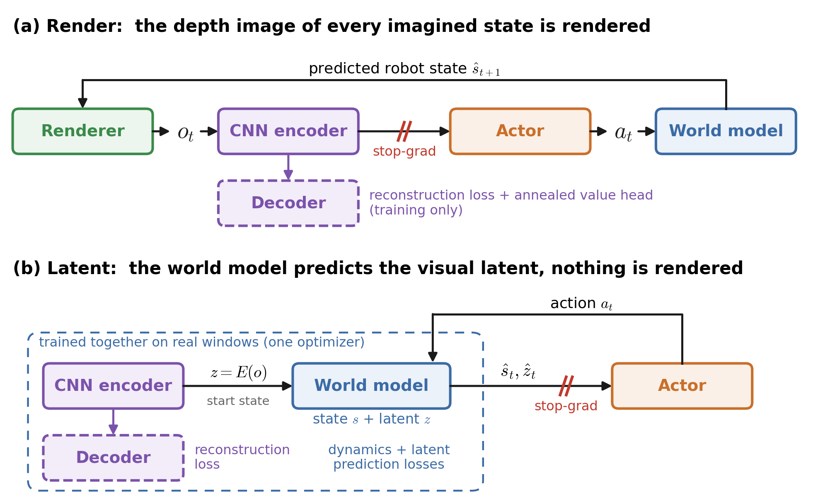

# SuperMimic world-model training for perceptive shadowing parkour (G1)

Trains the depth policy of the perceptive shadowing task inside a learned world model, following
[SuperMimic](https://arxiv.org/abs/2610.28480) (Liao et al., CoRL 2026) and its open reproduction
[supermimic_vibed](https://github.com/zita-ch/supermimic_vibed) (MIT, Chong Zhang).

- **Single stage, no PPO.** The simulator only collects data. A differentiable world model is fit to it, and the policy is trained by
  back-propagation through 32-step imagined rollouts with analytic task rewards and a critic bootstrap.
- **Two vision methods**, two tasks with their settings in code (`rl_cfg.py`), differing only in how the depth image enters
  imagination (the `vision` field):
  - `Instinct-Perceptive-Shadowing-Render-G1-v0`: the world model predicts the robot state only; every imagined step renders the depth
    image of the predicted state from the known scene, terrain and robot meshes (the env camera's own MuJoCo Warp ray-cast kernel and
    noise pipeline). The policy's depth encoder gets no policy gradient: it is trained by a reconstruction decoder and a value head
    annealed to 0 over iterations 3000 -> 6000 (see **Encoder training**).
  - `Instinct-Perceptive-Shadowing-Latent-G1-v0`: the world-model state also carries the latent z of the depth encoder and the world
    model predicts it; the encoder is trained by a reconstruction decoder; nothing is rendered in imagination (the replay buffer
    stores depth images instead).
- **Unchanged task and policy.** All domain randomization, camera noise and resets of the task are kept. The policy is the task's
  `EncoderActorCritic` (Conv2d depth encoder); checkpoints use the `OnPolicyRunner` format, so `instinct-play` and its ONNX export
  load them unchanged, whichever method trained them.

```bash
instinct-train Instinct-Perceptive-Shadowing-Render-G1-v0 --num-envs 1024
instinct-train Instinct-Perceptive-Shadowing-Latent-G1-v0 --num-envs 1024
```

Both run 8000 iterations; any field can still be overridden with `--agent.<field>`. `render` requires `aux_recon_weight` > 0 (the
reconstruction is what trains the depth encoder); `latent` rejects `aux_recon_weight` > 0, `aux_value_weight` > 0 and
`latent_policy_grad` != 0 (a `ValueError` is raised); `render` ignores the `latent_*` fields. The rest of this README describes the `render` method unless stated otherwise.



One imagination step of each method. (a) Render: the renderer casts the depth image of the predicted robot state, the CNN
encoder's feature enters the actor through a stop-gradient, the action drives the (frozen) world model to the next state. (b) Latent:
the CNN encodes the real depth image of the start state once, the world model predicts the next state and latent. In (b) the encoder
and its decoder are part of the world model: they are fit together with it on real 8-step windows by one optimizer (dynamics, latent
prediction against E(real image) with the target detached, and reconstruction, the encoder's only training signal). In (a) the
encoder is trained separately by its decoder (reconstruction of the clean image) and a value head annealed to 0. In both, the
policy gradient trains the actor only.

## Results

One RTX 3090, 1024 environments, dataset `20251116_50cm_kneeClimbStep1` (10 motions on 5 terrains). Play setting (each motion from
its first frame, no pushes, camera noise on, the three tracking terminations on); success = the whole motion without any termination.
Iteration 8000; one training seed per row.

| Method / setting | Success | Link pos error | Joint pos error | Evaluation |
|---|---|---|---|---|
| **Render** task (reconstruction + value head annealed 3000 -> 6000) | 94.9% | 0.046 m | 0.143 rad | 3 seeds x 256 envs |
| **Latent** task | 96.9% | 0.044 m | 0.134 rad | 128 envs |
| render, reconstruction only (no value head) | 91.0% | 0.048 m | 0.140 rad | 3 seeds x 256 envs |
| render, reconstruction + value head kept on | 87.4% | 0.050 m | 0.152 rad | 3 seeds x 256 envs |
| render, encoder trained by the policy gradient only (earlier variant, removed) | 94.5% | 0.049 m | 0.148 rad | 128 envs |

- Render task per motion: diveroll4 96% / 100% / 100% / 81% (4 terrains), rollVault11 100% / 100%, jumpsit2 92% / 99%, kneelClimbStep1
  92% / 88% (with / without wall). About 2.7 h of training (0.83 it/s while the value head is on, 11.6 GB peak).
- The value head mainly speeds up learning: at iteration 6000, 93.1% with the head kept on vs 74.2% with reconstruction only.
- The latent result comes from the run that introduced the method, on the code before both methods were merged (same design; the
  merged `latent` path was checked against that code on short runs, not retrained to 8000 iterations).
- Training the encoder by the policy gradient alone (earlier variant) gives a similar success rate but a degraded encoder: linear probes of its
  feature on real depth images (terrain class, wall / no wall, kneel progress) score below a randomly initialized encoder.

## Method

```
for each iteration:
    1. collect   run the current policy (+ action noise) in the task env for ~2.5 steps (UTD 0.4), store transitions
    2. fit WM    10 batches of k=8-step autoregressive windows: dynamics + contact (+ failure) losses
    3. policy    from real buffered states, imagine 32 steps with the frozen world model; analytic reward and soft
                 termination, critic bootstrap after 32 steps; maximize the return by BPTT
    4. critic    regress GAE(λ) targets computed on the imagined transitions
```

The first 500 iterations only fit the world model. Optimizers, learning rate (2e-4, cosine decay), gradient clipping, γ = 0.99,
λ = 0.95 and the update-to-data ratio follow SuperMimic.

**World model** (9.7M parameters, deterministic): MLP 3 × 2048 (LayerNorm, SiLU), `(s', contacts) = f(s, a, ξ, scan)`.
Inputs: heading- and position-invariant state (70), action (29), episode-constant simulation context ξ (friction, kp/kd, masses,
CoM, joint offsets; 188), terrain height scan from a heightmap (17 × 11). Outputs: frame-local state increments (integrated into
s') and per-body contact logits. Loss over 8-step windows that start from a real state: normalized state error and contact BCE.

**Rendered vision** (`render.py`, `depth.py`). The camera is a function of the torso pose and the scene is known, so the policy's
depth image is `o = f(S)`. `DepthRenderer` casts the sensor's own rays (per-env installation randomization included) from the
camera pose of the predicted state with the same mujoco_warp `rays` kernel as the env camera, on a private copy of the full model
with one world per imagined sample (nothing shared with the env's sensors): per step the predicted `qpos` is written, forward
kinematics and the BVH refit run, and the rays are cast with the camera's own geom groups and its skip-and-continue loop for hits
closer than `min_distance`, so the robot's own links occlude the image as in the env (self-occlusion; clean-image error vs the
sensor about 0, `render/clean_mae` in the log). `--agent.render-robot False` renders the terrain only (all samples packed into one
world; about 0.15 s per iteration cheaper). The result is the raw `distance_to_image_plane` (max-clipped). The sensor's noise
pipeline (contour, artifacts, stereo noise, blur, too-close; fresh random samples) is applied in `DepthPipeline.noised`, a stateless
fused re-implementation (about 10x faster than the sensor's functions, numerically the same for the deterministic stages and the same
distributions for the random ones, `python tests/supermimic/check_depth_noise.py`), followed by normalize + crop / resize,
so the policy sees the observation format of the env. The image is an input only: it is rendered without gradient and the actor
sees the feature of the policy's depth encoder E (exported as `0-depth_image.onnx`) through a stop-gradient. All 27 x 48 rays are needed: the output pixels depend on the raw pixels within 2 px (contour, blur) and the
too-close stage on whole columns. The whole cast sequence runs in one CUDA graph without host syncs.

**Encoder training.** E gets no policy gradient. An earlier variant trained it by the BPTT policy gradient alone (through the
rendered image, with the gradient of the image w.r.t. the predicted pose); E then degraded below a randomly initialized encoder: linear
probes of its feature on real depth images (terrain class, wall / no wall, kneel progress) were all lower than for random weights. That
variant is removed; two training-only losses train E (the exported policy is unchanged):

- reconstruction (`aux_recon_weight`, 1.0): a decoder reconstructs the clean depth image from E(noised image) of 2048 real buffered states per
  iteration (L1); during the world-model-only iterations E is pre-trained by it alone.
- value head (`aux_value_weight`, 1.0): a value head on the actor's own input (proprioception, commands, E(depth)) regresses the critic's
  GAE target of the imagined states, a task signal for E. It speeds up learning a lot (93% vs 74% success at iteration 6000, 3 seeds)
  but lowers the final precision if kept on (87% vs 91% at 8000), so it is annealed to 0 with `--agent.aux-value-anneal-start` /
  `--agent.aux-value-anneal-end` (as in Kickstarting): annealed 3000 -> 6000 it reaches 94.9% at 8000 (3 seeds x 256 envs).

```bash
instinct-train Instinct-Perceptive-Shadowing-Render-G1-v0 --num-envs 1024   # these settings are in the task's agent cfg
```

**Failure head** (optional, on by default): a continue predictor on privileged features, combined with the analytic soft
termination in imagination, `d = 1 − (1 − d_analytic)(1 − p_fail)`.

**Imagination.** The policy observation has exactly the format of the task's `policy` group (reference commands with noise, 8 steps
of noisy proprioception); the policy's own network (depth encoder + actor) acts on the rendered depth image. Rewards and terminations are
analytic re-implementations of the task's terms (sigmoid-softened terminations); the critic (MLP 256-128) uses privileged features.

**Simulator side.** The env runs with `auto_reset=False` (set by the runner), so terminal transitions stay in the buffer. The camera
noise models (contour, artifacts, stereo, blur, too-close) are enabled in `G1PerceptiveShadowingEnvCfg` and inherited by Play.

## Usage

The dataset is the task's `MOTION_FOLDER` (default `~/Datasets/20251116_50cm_kneeClimbStep1`, download it from the
[release](https://github.com/project-instinct/InstinctMJ/releases/latest)).

```bash
# train / resume (the replay buffer is refilled on resume)
instinct-train Instinct-Perceptive-Shadowing-Render-G1-v0 --num-envs 1024   # or Instinct-Perceptive-Shadowing-Latent-G1-v0
instinct-train Instinct-Perceptive-Shadowing-Render-G1-v0 --num-envs 1024 --agent.load-run <run> --agent.load-checkpoint model_<it>.pt
# evaluate (results in <run>/eval/; --run-dir <run> --watch evaluates every new checkpoint, --video-only records videos)
python -m instinct_mj.scripts.supermimic.evaluate --checkpoint <run>/model_<it>.pt --motion-folder <dataset> --num-envs 128
# viser web viewer
python webplay_supermimic.py <run>/model_<it>.pt
```

A run directory holds `model_<it>.pt` (policy, optimizer, normalizers; `OnPolicyRunner` format), `supermimic_state_<it>.pt` (world
model, failure head, critic and their optimizers; read on resume), `params/`, `git/` and TensorBoard events
(world-model losses, imagined vs. real terminations, policy / critic, simulator statistics).
Single GPU only.

## Configuration

All fields are in `config.py` (`SuperMimicRunnerCfg`, part of the task's agent cfg) and can be set as `--agent.<field>`
(e.g. `--agent.pi-batch 2048`, `--agent.fail-head False`). The main ones:

| Field | Default | Meaning |
|---|---|---|
| `buffer_steps`, `utd`, `warmup_steps` | 1000, 0.4, 64 | Replay buffer length, updates per simulator step, steps before the first update |
| `wm_window`, `wm_batches`, `wm_batch` | 8, 10, 2048 | Window length k, world-model steps per iteration, windows per batch |
| `wm_only_iters` | 500 | World-model-only iterations at the start |
| `fail_head`, `wm_failure_frac`, `wm_holdout_envs` | True, 0.25, 0.1 | Failure head, failure-window oversampling, held-out envs for diagnostics |
| `horizon`, `pi_batch` | 32, 1024 | Imagination horizon and starts per policy update |
| `gamma`, `lam`, `action_noise` | 0.99, 0.95, 0.1 | Discount, GAE λ, collection action noise |
| `lr`, `lr_decay_iters`, `lr_final_ratio` | 2e-4, 250000, 0.03 | Learning rate and cosine decay |
| `amp`, `compile`, `compile_policy` | `bf16`, True, True | bf16 MLPs, `torch.compile` of the world model and the imagination step |
| `vision` | `render` | `render` or `latent` (see the top of this README); `latent_windows`, `latent_weight`, `latent_recon_images`, `latent_recon_weight` are the `latent` method's fields |
| `render_robot` | True | Imagined depth images include the robot's own links (self-occlusion) |
| `aux_recon_weight`, `aux_recon_images` | 0, 2048 | Reconstruction loss weight (required > 0 for `render`) and images per update (see **Encoder training**) |
| `aux_value_weight`, `aux_value_anneal_start`, `aux_value_anneal_end` | 0, -1, -1 | Value-head loss into the depth encoder and its linear annealing to 0 |
| `checkpoint_imagination` | False | Gradient checkpointing of the imagination (less memory, more time) |

## Performance

RTX 3090, 1024 environments, render method: about 1.2 s per iteration (Render task: 0.83 it/s while the value head is on, 11.6 GB peak).
Per iteration: the imagination ray casts about
0.39 s (32 steps × 1024 samples × 27 × 48 rays, one CUDA graph per step, no host syncs), the world-model fit 0.27 s (bf16), the
simulator 0.23 s (of which the env camera is about a third) and the policy backward 0.15 s. `--agent.render-robot False` renders the
terrain only (about 0.15 s cheaper, but the encoder then never sees the robot's own links that the real camera sees).

## Files

| File | Content |
|---|---|
| `runner.py` | `SuperMimicRunner`, the task's runner: policy, normalizers, save / load, `export_as_onnx`; collection, world-model fit, imagination / BPTT, critic and logging (built lazily by `setup_training`) |
| `networks.py` | `WorldModel`, `LatentDecoder`, `ValueHead`, `FailureHead`, `Critic`, `RunningNorm` |
| `mdp.py` | Analytic rewards, terminations, policy observation, critic features |
| `kinematics.py`, `rotations.py` | Differentiable forward kinematics, rotation utilities |
| `terrain.py` | Terrain heightmap (ray-cast once, cached) and height scan |
| `buffer.py`, `sim.py`, `motion_lib.py` | Replay buffer, env readers, reference motions |
| `render.py`, `depth.py` | Depth renderer (terrain + robot ray casting with the env's kernel), fused camera noise pipeline / clean images |
| `scripts/supermimic/evaluate.py` | Evaluation entry point |
| `LICENSE-supermimic_vibed` | MIT license of the code adapted from supermimic_vibed |
| `tests/supermimic/` | Analytic-head checks against the env, camera-noise equivalence, compile parity, Play loading, failure diagnosis (latent design), benchmarks |

## Known limitations

- The world-model input scan uses a single-surface heightmap, so overhangs are not represented there (the rendered depth images
  use the exact meshes).
- The analytic heads use the post-step state, the env managers body poses one physics substep older (small differences near
  thresholds).
- Issues of the existing task: the critic `height_scan` observation is constant (the scanner only includes geom group 0, the terrain
  is in group 2; kept for checkpoint compatibility), and `TerrainMotion._safe_motion_resampling` can index past the end of a
  replacement motion for some seeds (seed 42 is safe).

## Differences from SuperMimic

| | SuperMimic | This package |
|---|---|---|
| Task | Motion tracking on flat ground | Perceptive motion tracking on terrain |
| World-model input | State, action, context | Adds the terrain height scan; context extended to 188 |
| Outputs | State increments | Adds contact logits, a failure head |
| Policy | MLP encoder / decoder | The task's own depth policy network |
| Vision | — | Depth rendered from the predicted state (render) or a visual latent in the world-model state (latent) |
| Reset sampling | Return-based bins | The task's adaptive motion bins |

## Acknowledgements

This work builds on **SuperMimic** (Liao et al., CoRL 2026), whose method this package follows, and on
[**supermimic_vibed**](https://github.com/zita-ch/supermimic_vibed) by Chong Zhang (ETH Zurich, MIT License), the open
reproduction from which the world model, replay buffer, rotation utilities and training loop were adapted. Many thanks to the
authors of both. This package is not affiliated with the SuperMimic authors.

```bibtex
@misc{liao2026supermimic,
  title         = {SuperMimic: Scaling Humanoid Whole-Body Control with One Differentiable World Model},
  author        = {Liao, Qiayuan and Shao, Yiyang and Long, Junfeng and Zakka, Kevin and Horowitz, Roberto and Abbeel, Pieter and Sreenath, Koushil},
  year          = {2026},
  eprint        = {2610.28480},
  archivePrefix = {arXiv},
  primaryClass  = {cs.RO},
  note          = {CoRL 2026},
  url           = {https://arxiv.org/abs/2610.28480}
}

@misc{zhang2026supermimicvibed,
  title        = {supermimic\_vibed: an open reproduction of SuperMimic},
  author       = {Zhang, Chong},
  year         = {2026},
  howpublished = {\url{https://github.com/zita-ch/supermimic_vibed}}
}
```
